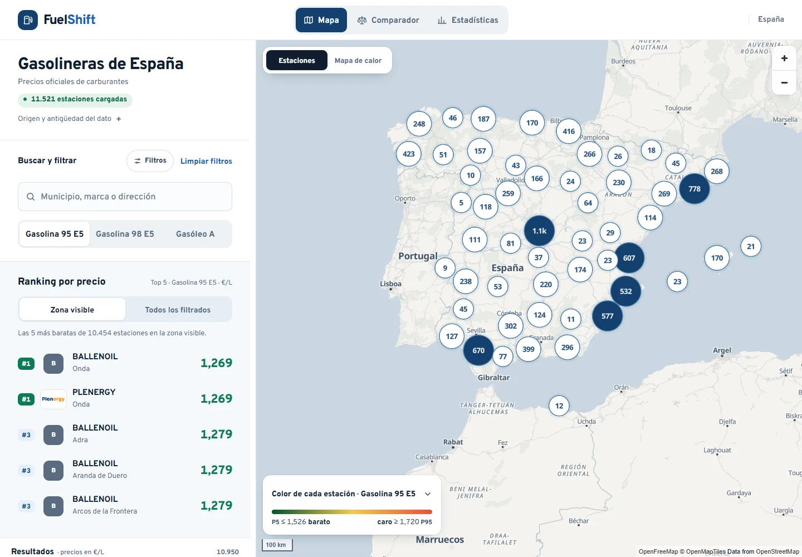
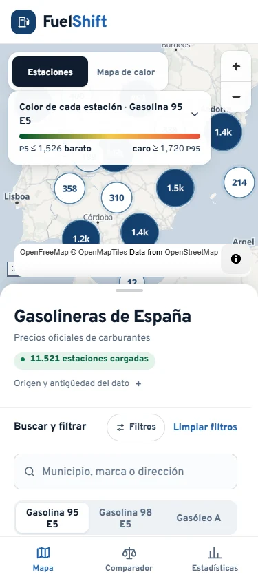
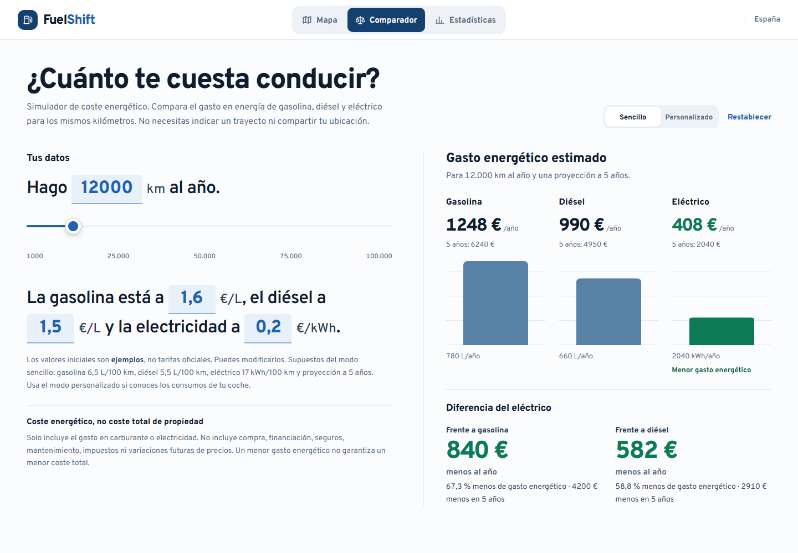
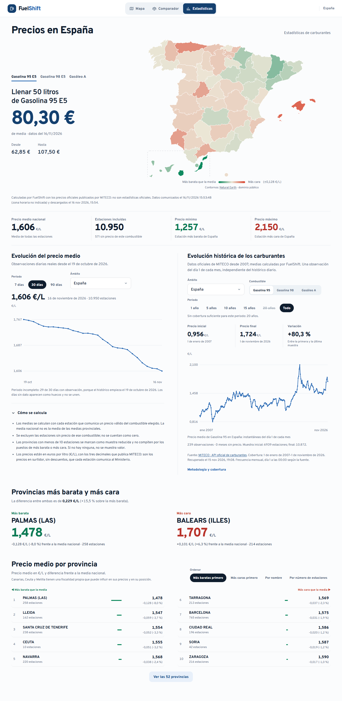

# FuelShift

**Web: <https://fuelshift.pages.dev>**

FuelShift es una aplicación web pública para consultar precios oficiales de carburantes en
España, comparar costes energéticos y explorar su evolución. El mapa es el centro de una
interfaz azul y verde adaptada a escritorio y móvil, con filtros, ranking y fichas de estaciones.
El comparador permite editar los supuestos de consumo y precio, y las estadísticas reúnen un
mapa provincial, indicadores e históricos independientes: observaciones diarias de FuelShift
desde octubre de 2026 y fotografías oficiales de MITECO con muestreo mensual desde 2007.

Las versiones del código se registran en [CHANGELOG.md](CHANGELOG.md). La fecha de los datos es
otra cosa: la aplicación indica las fechas de los datos y de su recuperación.



<p align="center">
  <a href="docs/img/mapa-movil.webp">
    
  </a>
</p>





Capturas reales de [la web publicada](https://fuelshift.pages.dev), tomadas con Playwright el
**16 de noviembre de 2026**, sin modificar la interfaz ni los datos. Los precios actuales se
descargaron ese día; el diario mostrado abarca del 19/10/2026 al 16/11/2026 y el mensual, de
enero de 2007 a noviembre de 2026. Las imágenes están optimizadas en WebP.

## Qué hace

- **Mapa de gasolineras** con las ~11 500 estaciones terrestres de MITECO: búsqueda, filtros por
  combustible, marca y precio, orden por precio o distancia, geolocalización opcional, ranking de
  las más baratas, mapa de calor de precios y ficha de cada estación con horario, todos sus precios
  y cómo llegar.
- **Comparador** del gasto energético de un coche de gasolina, diésel o eléctrico (solo energía,
  no coste total de propiedad): modos sencillo y personalizado, cifras editables, sliders,
  gasto anual y proyección a varios años. Puede usar el precio de una estación si se llega desde
  el mapa; los valores iniciales del simulador son ejemplos editables, no tarifas oficiales.
- **Estadísticas**: mapa de diferencias provinciales, medias nacional y por provincia, mínimos,
  máximos, coste de un depósito de referencia y ranking provincial.
- **Histórico diario** desde el **19 de octubre de 2026**: observaciones conservadas por
  FuelShift a partir de sus ingestas de precios actuales de MITECO.
- **Histórico oficial con muestreo mensual** desde **enero de 2007**: fotografías de MITECO del
  día 1 de cada mes, para España y los 52 ámbitos provinciales, con selección de combustible,
  ámbito y periodo según la cobertura real.

- **Repostar cerca de mí y durante un viaje**: ordena gasolineras por ahorro neto con
  distancias y tiempos reales por carretera, calculados por Geoapify a través de un Worker
  propio de Cloudflare (ADR 0007). Solo consulta al pulsar, con presupuesto diario y límites
  por visitante; si el servicio no está disponible, el resto de la web sigue funcionando.
- **[Privacidad](https://fuelshift.pages.dev/privacidad/)**: sin cuentas, cookies ni
  analítica; la página explica qué datos se envían, a quién y durante cuánto tiempo.

Ambos históricos muestran gasolina 95 E5, gasolina 98 E5 y gasóleo A. Las medias las calcula
FuelShift a partir de los precios oficiales de estaciones; no son estadísticas publicadas por
MITECO. Las dos series se presentan por separado y no se rellenan los huecos con datos inventados.

## Stack

- Next.js 16 con App Router y exportación estática, React 19 y TypeScript estricto.
- Tailwind CSS 4, MapLibre GL JS, fuentes locales y gráficos SVG propios, sin librería de gráficos.
- Vitest, Playwright con Edge/Chrome/Chromium instalado, ESLint y Prettier para verificar el frontend.
- Python 3.12, Pydantic, Pytest y Ruff para el pipeline de datos.
- GitHub Actions con controles reproducibles y servicios gratuitos.

No se usan bases de datos, autenticación ni APIs de pago. El mapa usa la instancia pública y
gratuita de OpenFreeMap, sin clave; no ofrece garantía de disponibilidad. Las rutas usan el plan
Free de Geoapify desde un Worker en Cloudflare Workers Free con Durable Objects SQLite
(`workers/routing/`), que guarda la clave como secreto y limita el consumo a 2400 créditos por
cada 24 h. Geoapify confirmó por escrito el 27 de noviembre de 2026 que superar la cuota Free
no genera cargos: las peticiones se rechazan con HTTP 429.

## Requisitos e instalación

En Windows se necesita Git, Node.js 24 con npm 11 y Python 3.12. Desde PowerShell, en la raíz
del repositorio:

```powershell
npm ci
py -3.12 -m venv .venv
.\.venv\Scripts\python.exe -m pip install -r requirements-dev.lock
```

Las dependencias JavaScript quedan fijadas en `package-lock.json` y las herramientas Python en
`requirements-dev.lock`.

## Ingesta oficial de MITECO

La ingesta realiza una única descarga del conjunto nacional desde el
[servicio REST oficial de MITECO](https://energia.serviciosmin.gob.es/ServiciosRestCarburantes/PreciosCarburantes/EstacionesTerrestres/),
valida y normaliza el contenido, genera los archivos en un directorio provisional y sustituye
el conjunto local anterior solo si todos los controles terminan correctamente.

```powershell
$env:PYTHONPATH = "pipeline/src"
.\.venv\Scripts\python.exe -m fuelshift_data --output data/processed/miteco
```

La salida, ignorada por Git, contiene `manifest.json` y un JSON por identificador oficial de
provincia dentro de `provinces/`. El orden es determinista y el manifiesto incluye hashes,
procedencia, licencia, fechas separadas y métricas de calidad. El contrato completo está en
[`docs/static-data-contract.md`](docs/static-data-contract.md).

Por defecto, la ejecución falla si recibe menos de 10 000 estaciones, rechaza más del 2 % o el
número de estaciones válidas cae más de un 20 % respecto al último manifiesto. Los umbrales se
pueden ajustar mediante las opciones de la CLI. Un timeout, error HTTP, JSON inválido, respuesta
vacía o fallo de validación tampoco reemplaza el último conjunto válido.

Los precios se conservan como cadenas decimales exactas y los valores vacíos se omiten. La API
solo comunica una fecha global sin zona horaria explícita y no aporta una fecha individual por
precio. La API tampoco declara unidades, pero el conjunto procede de la Orden ITC/2308/2007, cuyos
anexos vigentes (Resolución de 5 de diciembre de 2025) fijan euros por litro para gasolinas,
gasóleos, biodiésel, bioetanol, combustibles renovables, GLP y AdBlue, y euros por kilogramo para
gas natural, biogás, hidrógeno, metanol y amoniaco. La web muestra la unidad de cada producto
según esa norma. Las fuentes, la correspondencia de los 23 productos y las demás limitaciones
están en [`docs/data-contract.md`](docs/data-contract.md).

El catálogo oficial publica el conjunto bajo
[Creative Commons Attribution 4.0](https://creativecommons.org/licenses/by/4.0/). Toda
redistribución debe mantener la atribución a MITECO, enlazar la licencia e indicar las
transformaciones realizadas.

## Preparar y abrir el mapa

Después de ejecutar la ingesta, valida y prepara la copia estática que sirve Next.js:

```powershell
$env:PYTHONPATH = "pipeline/src"
.\.venv\Scripts\python.exe -m fuelshift_data --output data/processed/miteco
npm run data:prepare
npm run dev
```

Abre <http://localhost:3000>. `npm run data:prepare` valida de nuevo versión, rutas, tamaños,
hashes SHA-256, recuentos e identificadores antes de sustituir `public/data/miteco/`. Los datos
de origen y la copia web están ignorados por Git. Si no se han preparado datos, el build sigue
funcionando y la interfaz muestra un estado vacío explícito.

El navegador descarga el manifiesto y las provincias progresivamente con concurrencia limitada,
las conserva en memoria y delega el clustering visual en MapLibre. La geolocalización solo se
solicita al pulsar «Usar mi ubicación» y no se persiste.

La vista «Mapa de calor» reutiliza esas estaciones y no descarga nada más. Representa las mismas
estaciones que la lista: el combustible elegido y los filtros activos. En el navegador calcula una
superficie de precios con píxeles de 0,05° (unos 5 km): cada píxel es la media de los precios
cercanos ponderada con un núcleo gaussiano de σ = 8 km, con un alcance de 24 km. Al ser una media,
la densidad de estaciones no cambia el color, solo la opacidad. Donde no hay estaciones cerca, el
mapa queda transparente. MapLibre dibuja la superficie como imagen con interpolación lineal, así
que se ve como un degradado continuo. La escala va de verde a rojo pasando por amarillo, entre los
percentiles 5 y 95 de la superficie **nacional sin filtrar** de cada combustible. Por eso no cambia
al filtrar ni al mover el mapa, y un mismo precio conserva su color. La leyenda distingue esos
límites de los precios mínimo y máximo reales de las estaciones mostradas. Sin filtros activos se
reutiliza el cálculo nacional; con filtros solo se recalcula la superficie, no la escala. La rampa
usa los colores ya validados para daltonismo y la leyenda rotula los extremos con texto.

## Estadísticas

La página `/estadisticas` se calcula durante `npm run build`: el proceso de build lee la copia
validada de `public/data/miteco/` y el navegador recibe los agregados, sin descargar el conjunto
completo de estaciones. Muestra, para Gasolina 95 E5, Gasolina 98 E5 y Gasóleo A, la media
nacional calculada con todas las estaciones válidas, el mínimo y el máximo reales, la media por
provincia y su diferencia con la media nacional. Las provincias con menos de 10 estaciones se
marcan como muestra reducida y las que no tienen datos se muestran sin valor. Son estadísticas
calculadas por FuelShift, no publicadas por MITECO. El mapa provincial y el coste de un depósito
de referencia de 50 litros ayudan a comparar esos mismos datos.

### Dos históricos, dos fuentes temporales

|              | Diario de FuelShift                                                                                  | Histórico oficial de MITECO con muestreo mensual                                                                        |
| ------------ | ---------------------------------------------------------------------------------------------------- | ----------------------------------------------------------------------------------------------------------------------- |
| Fuente       | Ingestas de precios actuales y estadísticas calculadas en cada build.                                | Respuestas históricas oficiales de `EstacionesTerrestresHist/{FECHA}`; FuelShift calcula las medias.                    |
| Inicio       | 19 de octubre de 2026; no reconstruye días anteriores.                                               | 1 de enero de 2007, primera fecha admitida por la API.                                                                  |
| Frecuencia   | Como máximo una observación por día con dato conservado; no es una media de todas las horas del día. | Una fotografía del día 1 de cada mes a las 00:00 según la API; no es la media de todos los días del mes.                |
| Cobertura    | España y provincias con datos; periodos de 7, 30 y 90 días, con aviso si están incompletos.          | España y los 52 ámbitos provinciales, incluidas Ceuta y Melilla; periodos disponibles según la serie elegida.           |
| Persistencia | Registros diarios en la rama `data/historico` y copia publicada.                                     | Base estática, artefactos validados y recuperación de la última copia publicada.                                        |
| Limitaciones | Puede haber días sin observación.                                                                    | Puede haber meses sin precio para un combustible o ámbito; los cambios de estaciones afectan a la comparación temporal. |

Las medias nacionales se calculan sobre estaciones con precio válido, no sobre medias
provinciales. Los gráficos muestran las fechas y los recuentos de cada serie y mantienen sus
huecos explícitos; no mezclan el diario reciente con el mensual desde 2007.

### Histórico diario

El build también publica la instantánea en `/data/estadisticas.json`, que
`scripts/price-history.mjs` convierte en un registro diario del histórico. El guardado automático
en la rama de datos `data/historico` está activo y conserva observaciones reales desde el 19 de
octubre de 2026. La página descarga el histórico publicado en `/data/historico/`; si no hubiera
ninguno, muestra «Todavía no hay histórico». Véase [docs/price-history.md](docs/price-history.md).

### Histórico oficial con muestreo mensual desde 2007

La base implementada contiene **239 fotografías mensuales, de enero de 2007 a noviembre de
2026**, y 159 series: España y 52 ámbitos provinciales para los tres combustibles. Ese intervalo
no cubre todavía 20 años completos. La cobertura concreta se muestra por serie: por ejemplo,
hay meses sin gasolina 98 E5 en Melilla y no se representan como precio cero.

La web carga `/data/historico-miteco/manifest.json` y solo el JSON del ámbito y combustible
seleccionados. Conserva la fuente, las fechas solicitada y devuelta, la recuperación, las
exclusiones y la procedencia de cada muestra. La actualización incremental está programada para
el día 3 de cada mes y requiere `MITECO_MONTHLY_ENABLED=true`; recupera los meses pendientes con
un máximo de tres descargas por ejecución. Si falla, conserva el último conjunto válido.

La metodología, los contratos, los huecos de cobertura y los comandos de reproducción están en
[`docs/miteco-monthly-history.md`](docs/miteco-monthly-history.md).

## Desarrollo y comprobaciones

La [metodología de desarrollo asistido por IA](docs/desarrollo-ia.md) define tareas,
perfiles, uso de recursos y revisión; [AGENTS.md](AGENTS.md) mantiene las reglas
compartidas y reserva al propietario todas las operaciones de escritura en Git.

```powershell
# Servidor local
npm run dev

# Frontend
npm run format:check
npm run lint
npm run typecheck
npm test
npm run test:coverage
npm run build

# Prueba E2E automatizada con Playwright (requiere la web en ejecución y Edge, Chrome o Chromium local;
# FUELSHIFT_URL cambia la dirección, por defecto http://localhost:3000)
npm run test:browser

# Worker de rutas en workerd local (Wrangler), con proveedores simulados y sin red
node scripts/routing-runtime-smoke.mjs

# Python (las pruebas usan fixtures y no acceden a la red)
.\.venv\Scripts\python.exe -m ruff format --check pipeline
.\.venv\Scripts\python.exe -m ruff check pipeline
.\.venv\Scripts\python.exe -m pytest
```

`npm run build` genera la exportación estática en `out/`; tanto `out/` como `.next/` están
ignorados por Git. El workflow manual `Verificación manual MITECO` permite comprobar la descarga
real y conservar el resultado durante un día como artefacto; no programa ingestas ni publica
datos persistentes.

`npm run test:coverage` mide `src/lib`, `src/domain` y `src/data`; los scripts de `scripts/` se
prueban ejecutándolos como procesos y quedan fuera de esa medición.

En Windows, Next.js 16.4 escribe ciertos fragmentos de rutas anidadas como
`out/comparador/__next.comparador/__PAGE__.txt` en lugar de `__next.comparador.__PAGE__.txt`.
La navegación actual usa enlaces HTML entre las páginas y no depende de precargar esos
fragmentos RSC. Los builds de CI y de Cloudflare Pages se generan en Linux.

## Estructura

```text
src/
  app/                 Rutas, layout y estilos globales de Next.js
  components/          Componentes visuales
  data/                Carga y validación de los JSON publicados
  domain/              Tipos y reglas de dominio del frontend, sin React ni E/S
  lib/                 Utilidades genéricas, sin dependencias de las demás capas
pipeline/
  src/fuelshift_data/
    download.py         Cliente HTTP limitado y con reintentos
    normalization.py    Adaptación del contrato oficial verificado
    models.py           Modelos normalizados validados
    validation.py       Controles de calidad y comparación histórica
    generation.py       JSON determinista y publicación transaccional
    pipeline.py         Orquestación de la ingesta
    cli.py              Interfaz de línea de comandos
    monthly_history.py  Recuperación y agregación del histórico oficial mensual
    monthly_delivery.py Validación, recuperación y entrega de las series mensuales
  tests/                Pruebas aisladas de la red
contracts/              JSON Schema de los datos publicados y ejemplos
scripts/                Preparación de datos, histórico, vigilancia y pruebas de navegador
public/_headers         Cabeceras de seguridad de Cloudflare Pages
docs/                   Contratos, decisiones (decisions/), operación, publicación y capturas
.github/workflows/      Integración continua, despliegue, vigilancia y verificación manual
```

En `src/`, las dependencias solo avanzan en el sentido `app → components → data → domain`, y
cualquier capa puede usar `lib`. ESLint lo comprueba con `no-restricted-imports`
([`eslint.config.mjs`](eslint.config.mjs)); las pruebas quedan exentas.

El despliegue estático en Cloudflare Pages Free comprueba MITECO cada cuatro horas y también puede
ejecutarse manualmente. Las ejecuciones programadas pueden retrasarse; la web muestra la fecha
de descarga y avisa si los datos son antiguos. Publica cuando cambia el contenido normalizado
de las estaciones o hay cambios que entregar en los históricos; una ejecución manual puede
forzar la publicación de cambios de código sin omitir ninguna validación.
Una comprobación programada sin cambios no ejecuta el build ni Wrangler. La configuración, los
secretos, la protección del manifiesto anterior, la recuperación y los límites están documentados en
[`docs/deployment-cloudflare.md`](docs/deployment-cloudflare.md).

## Vigilancia y alertas

Cada hora, el workflow [`vigilancia-produccion.yml`](.github/workflows/vigilancia-produccion.yml)
comprueba la web publicada (páginas, recursos, manifiesto, hashes provinciales, antigüedad de los
datos, estadísticas, histórico y fallos seguidos de la ingesta). Si algo falla abre una incidencia
`alerta-produccion` en GitHub, que notifica al propietario, y la cierra sola al recuperarse. Los
umbrales, el diagnóstico y la recuperación están en [`docs/monitoring.md`](docs/monitoring.md).

## Seguridad y versiones

La versión actual es la **1.1.0** (16 de noviembre de 2026), que añade el histórico mensual
oficial desde 2007 y el rediseño. Las versiones etiquetadas y las fechas de los datos son
independientes.

La web no usa credenciales en el navegador ni servicios de pago. El Worker de rutas lo
despliega a mano el propietario; su activación, desactivación de emergencia y garantías están en
la [ADR 0007](docs/decisions/0007-intermediario-de-rutas.md), y el tratamiento de datos, en la
página `/privacidad/` (`src/app/privacidad/page.tsx`). Las cabeceras de seguridad
(CSP, `X-Frame-Options`, `Permissions-Policy` y otras) se publican desde `public/_headers`; su
motivo y cómo se probaron están en [`docs/security-headers.md`](docs/security-headers.md). Los
cambios de cada versión se recogen en [`CHANGELOG.md`](CHANGELOG.md) y el procedimiento de
publicación, verificación y vuelta atrás en [`docs/release.md`](docs/release.md).

## Licencia

El código se publica con licencia [MIT](LICENSE). Los datos de precios son de MITECO y se
redistribuyen con licencia [CC BY 4.0](https://creativecommons.org/licenses/by/4.0/), con
atribución y las transformaciones indicadas arriba.
